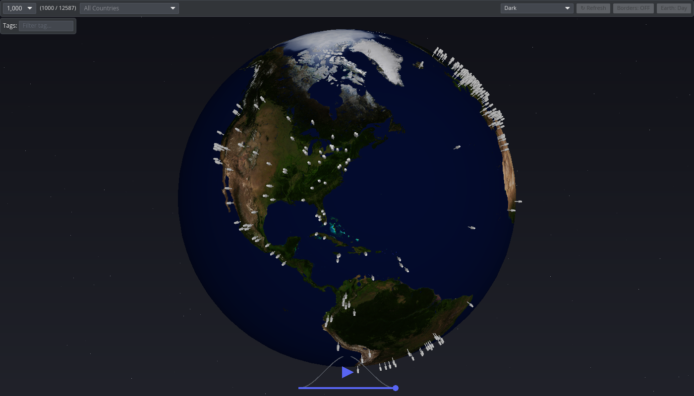

# Ratlas

Interactive 3D Radio Atlas and Streaming Player built with Rust, Iced, and WGPU.

Explore and tune in to thousands of live radio stations worldwide directly on an interactive 3D globe.



---

## Features

- **Real-time 3D Earth Globe**: Rendered via WGPU hardware acceleration with custom shaders, day and night textures, specular ocean maps, country outlines, and smooth orbital camera controls.
- **Radio Browser Integration**: Backed by the community-driven [Radio Browser](https://www.radio-browser.info/) API with thousands of geographically mapped stations.
- **Multi-format Stream Playback**: Native audio playback supporting MP3, AAC/ADTS, and Ogg/Opus streams powered by `rodio`.
- **Filter and Search**: Search and filter by tags, genres, country, and popularity to find stations easily.
- **Spatial Proximity Selection**: Hover over and click 3D pins on the globe to view station information and tune in immediately.
- **System Tray Support**: Minimize to the system tray while keeping audio playback running smoothly in the background.
- **Custom Themes**: Built with modern [Iced](https://iced.rs/) UI and configurable themes.

---

## Installation and Download

Pre-built binaries are available on the [Releases](https://github.com/florianfelix/ratlas/releases) page.

### Linux (AppImage)

1. Download `Ratlas-x86_64.AppImage` from the latest release.
2. Make it executable and run:
   ```bash
   chmod +x Ratlas-x86_64.AppImage
   ./Ratlas-x86_64.AppImage
   ```

### Windows (Zip)

1. Download `Ratlas-Windows-x86_64.zip` from the latest release.
2. Extract the archive.
3. Run `ratlas.exe`.

---

## Building from Source

### Prerequisites

- [Rust](https://rustup.rs/) (2024 edition compatible compiler, Rust 1.85+)
- [Just](https://github.com/casey/just) command runner (optional, but convenient)

#### Linux Build Dependencies

On Debian / Ubuntu:
```bash
sudo apt update
sudo apt install build-essential pkg-config libasound2-dev libssl-dev libx11-dev
```

On Fedora:
```bash
sudo dnf install alsa-lib-devel openssl-devel libX11-devel
```

On Arch Linux:
```bash
sudo pacman -S alsa-lib openssl libx11
```

### Running Locally

```bash
# Clone the repository
git clone https://github.com/florianfelix/ratlas.git
cd ratlas

# Run in release mode
cargo run --release
# or using just:
just dev
```

### Packaging

- **Linux AppImage**:
  ```bash
  just appimage
  ```
- **Windows Standalone Zip** (cross-compiling with MinGW):
  ```bash
  just windows-zip
  ```

---

## Controls

| Action | Control |
| :--- | :--- |
| **Rotate Globe** | Left Mouse Button + Drag |
| **Zoom In / Out** | Mouse Scroll Wheel |
| **Inspect / Select Station** | Click on station marker |
| **Play / Pause** | Media control bar or Spacebar |

---

## License

Licensed under either of:

- Apache License, Version 2.0 ([LICENSE-APACHE](LICENSE-APACHE))
- MIT License ([LICENSE-MIT](LICENSE-MIT))

at your option.
